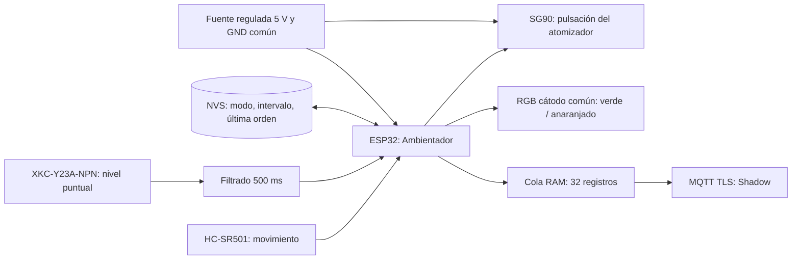
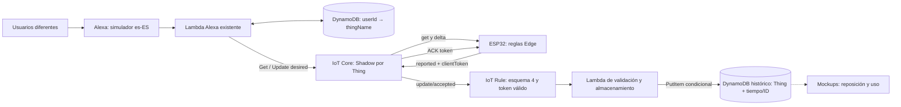
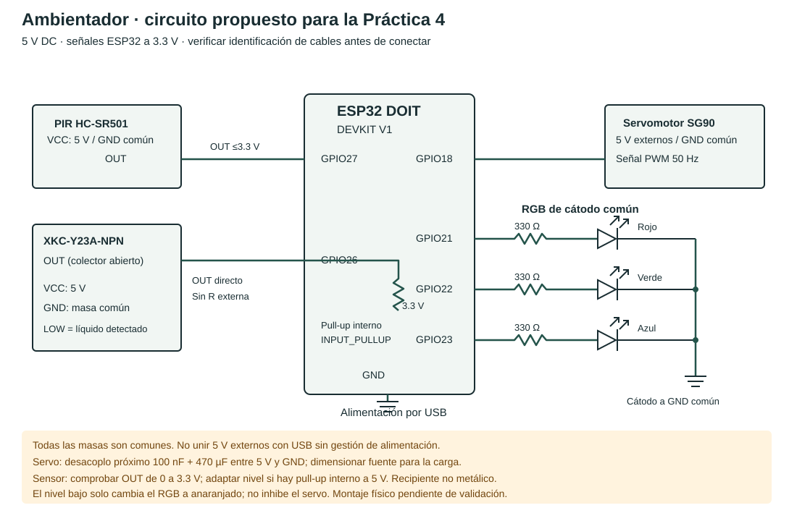
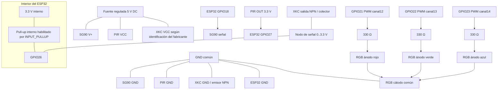
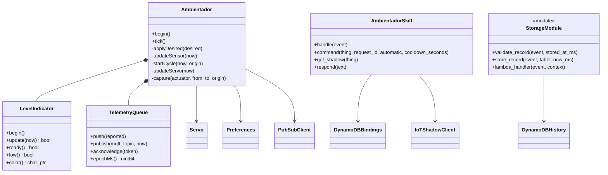
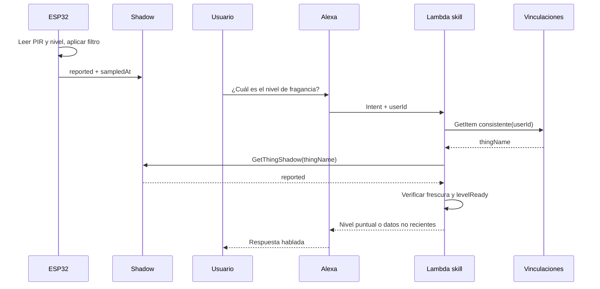
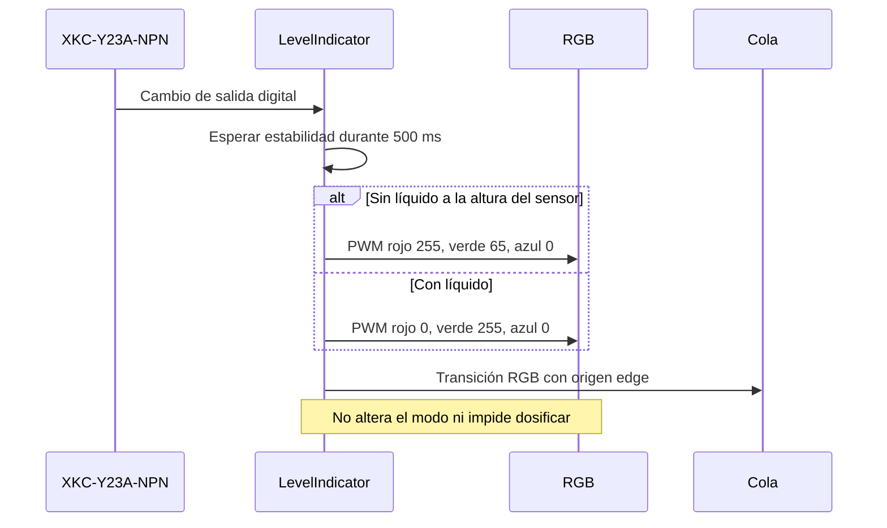
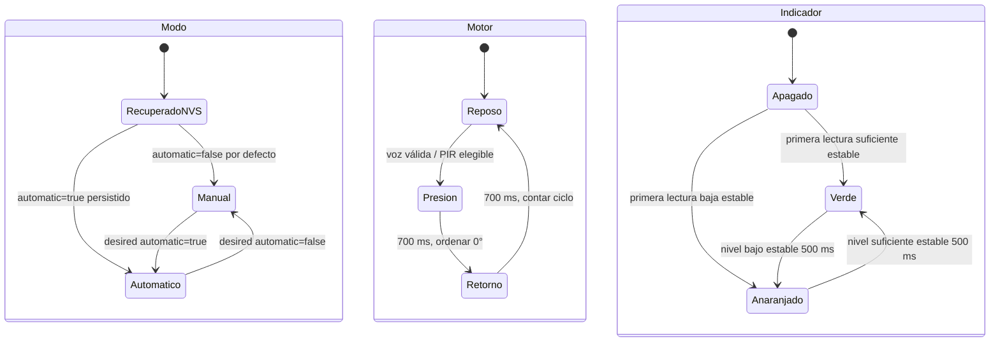

# Diseño del sistema

Diagramas de la versión implementada; el montaje y las mediciones físicas siguen pendientes. Los contratos y patrones de acceso están en [contratos](contratos.md), y los pines en [configuración](configuracion.md).

## Bloques del objeto



## Arquitectura



Los mockups no se conectan a AWS. No hay ruta Alexa → dispositivo fuera del Shadow ni control de actuadores desde la Lambda de almacenamiento.

## Circuito propuesto



[Abrir esquema SVG](circuito.svg). El diagrama siguiente detalla también las redes de alimentación y masa.



ESP32 alimentado por USB; fuente de 5 V del servo con masa común. No unir dos fuentes de 5 V ni alimentar el servo desde GPIO/3V3. Añadir desacoplo próximo al servo (100 nF y 470 µF propuestos, verificar respuesta de la fuente). Identificar cables por el diagrama del ejemplar, no por colores supuestos. Comprobar que OUT no entrega 5 V antes de conectar GPIO26; con colector abierto desconectado puede quedar flotante. El esquema presupone salida NPN de colector abierto; si el ejemplar incluye pull-up interno a 5 V, emplear adaptación de nivel. GPIO26 usa exclusivamente el pull-up interno del ESP32, sin resistencia externa ni cable a 3V3; las resistencias del RGB permanecen. Verificar niveles y estabilidad tras inicializar el firmware. Fuente y todas las cargas permanecen por debajo de 12 V DC.

## Clases y módulos



La Lambda histórica es funcional; el rectángulo `StorageModule` representa un módulo, no una clase artificial. El backend Alexa mantiene la clase ya existente para reutilizar clientes y facilitar pruebas con dobles.

## Consulta de sensores por voz



Una consulta no fuerza una lectura directa en la placa: usa el último reporte, con su fecha. La misma secuencia aplica a PIR, motor, LED, modo e intervalo.

## Comando de voz sobre el motor

```mermaid
sequenceDiagram
  actor U as Usuario
  participant A as Alexa
  participant L as Lambda skill
  participant V as Vinculaciones
  participant SH as Shadow
  participant ESP as ESP32
  participant S as Servo
  U->>A: Activa el ambientador
  A->>L: ActivarIntent + requestId + userId
  L->>V: Resolver Thing
  L->>SH: GET y verificar orden pendiente
  L->>SH: UPDATE desired.activationId con version
  SH-->>ESP: delta (o GET tras reconexión)
  L-->>A: Solicitud enviada, no confirmación mecánica
  A-->>U: Respuesta
  ESP->>ESP: Validar ID y persistir antes de mover
  ESP->>S: 180°; luego 0°; terminar ciclo
  ESP->>ESP: Capturar tres eventos, origin=voz
  ESP->>SH: reported + ACK de activationId
```

Cambiar modo/intervalo usa el mismo flujo, pero se persiste el parámetro y se confirma en `reported`; no mueve el servo por sí solo.

## Almacenamiento

```mermaid
sequenceDiagram
  participant E as ESP32 / cola
  participant S as Shadow
  participant R as IoT Rule
  participant L as Lambda almacenamiento
  participant D as DynamoDB histórico
  E->>S: update reported (messageId, clientToken)
  S-->>E: update/accepted mismo token
  E->>E: Retirar cabeza de cola
  S->>R: update/accepted
  R->>R: Filtrar esquema/token; enriquecer Thing y recepción
  R->>L: Invocación asíncrona
  L->>L: Validar tipos, rangos y coherencia
  alt Mensaje válido
    L->>D: PutItem con condición de no existencia
    D-->>L: Guardado / ya existe
  else Mensaje inválido
    L->>L: Descartar sin escribir
  end
```

Un error transitorio de DynamoDB se propaga para reintento; una invocación repetida no genera otra fila. ACK y almacenamiento son dos confirmaciones distintas.

## Regla automática PIR y temporización

```mermaid
sequenceDiagram
  participant P as PIR
  participant E as Ambientador
  participant M as Servo
  participant Q as Cola
  P->>E: Flanco LOW → HIGH después de estabilización
  E->>E: automatic && idle && intervalo cumplido
  E->>M: 180°
  E->>Q: idle → pressing, origen edge
  Note over E: Pasan al menos 700 ms, sin espera bloqueante
  E->>M: 0°
  E->>Q: pressing → returning, origen edge
  Note over E: Pasan al menos otros 700 ms
  E->>Q: returning → idle, origen edge
  Note over E,Q: Funciona sin WiFi; cola limitada
```

## Regla automática de nivel y RGB



## Estados ortogonales



El modo, el motor y el indicador no se excluyen entre sí: puede dosificarse con LED anaranjado en cualquiera de los modos. Una pérdida de WiFi no cambia estas máquinas de estados.
