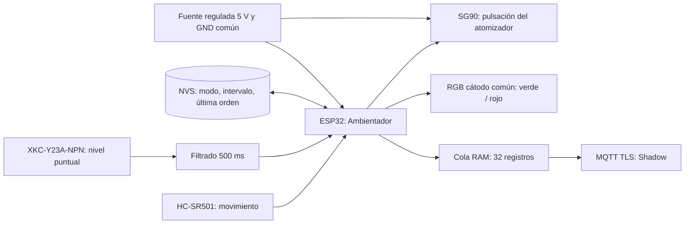
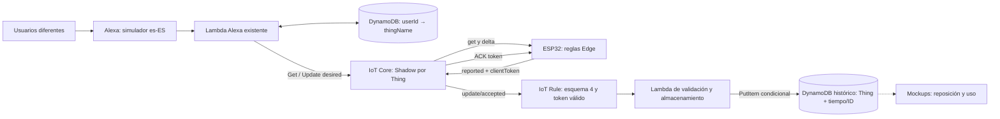
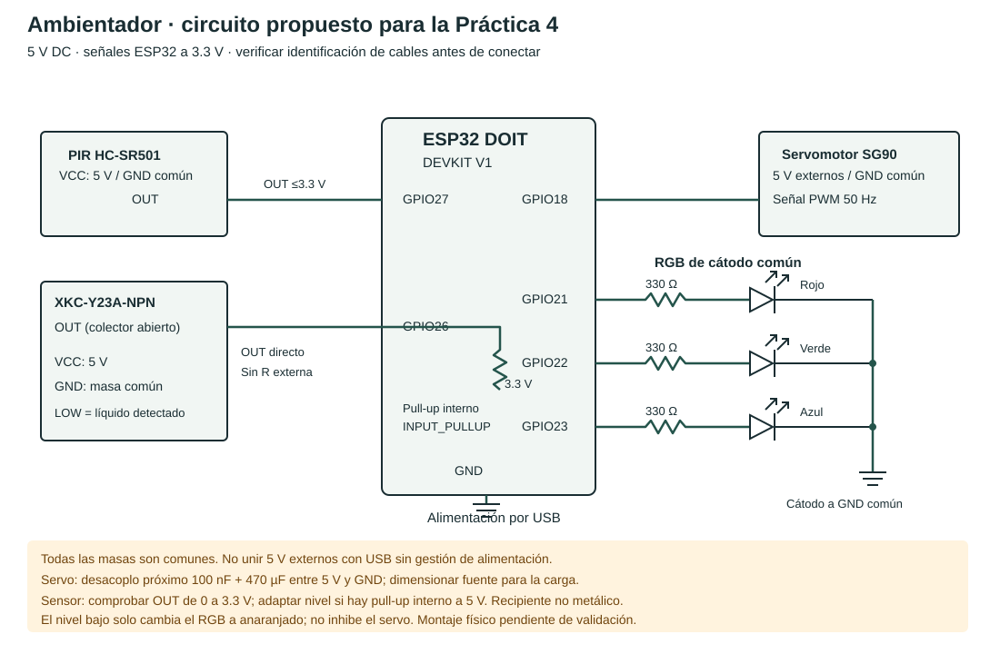
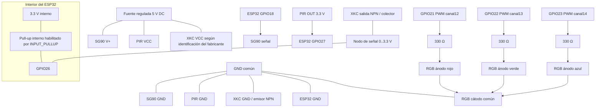
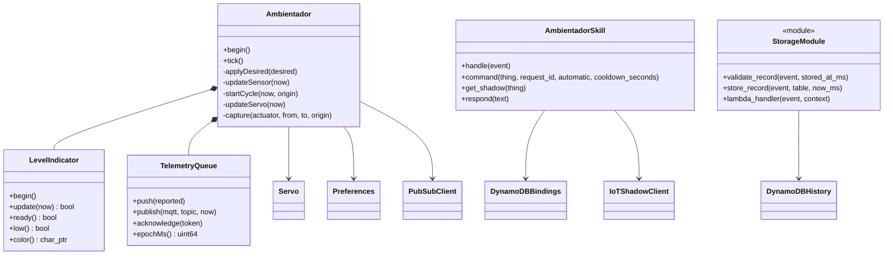
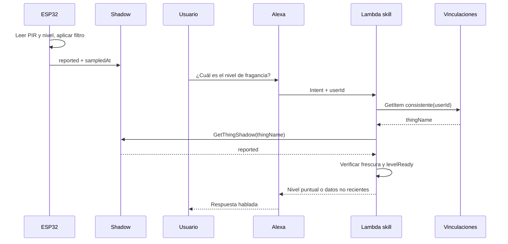
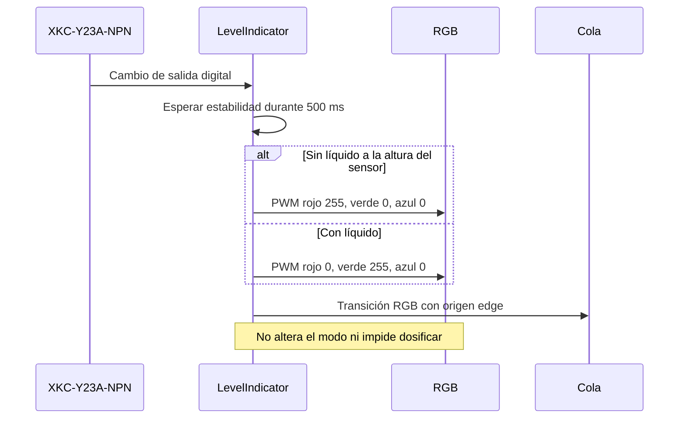
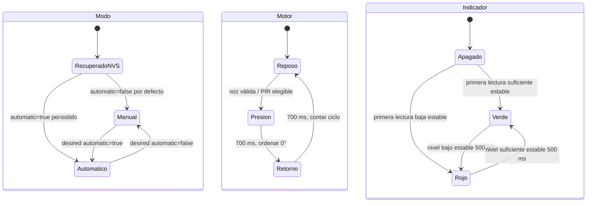
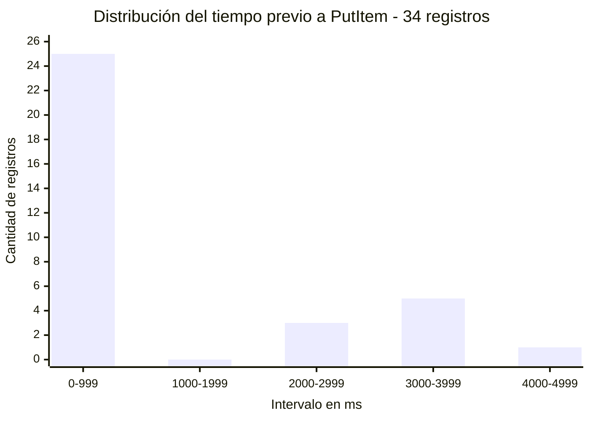

# Informe técnico — Práctica 4
# Ambientador inteligente: procesamiento, almacenamiento y control con AWS y Alexa

| Identificación | Información |
|---|---|
| Universidad | UNIVERSIDAD CATÓLICA BOLIVIANA — SEDE COCHABAMBA |
| Carrera | Ingeniería de Sistemas |
| Asignatura | Internet de las Cosas — SIS-234 |
| Grupo | N2 |
| Integrantes | Jose Franz Corrales Agreda; Rasshid Lopez Mejia; Alejandro Bustamante Del Castillo |
| Docente / facultad | Datos institucionales consignados en la portada |
| Gestión | 2026 |
| Fecha límite de la consigna | 24 de noviembre de 2026, 17:45 |
| Repositorio | [Practica-4-IOT](https://github.com/JoseCorralesAgreda/Practica-4-IOT) |

**Versión documental:** informe técnico final con las evidencias incorporadas hasta el 24 de noviembre de 2026.

## Resumen

El ambientador integra un ESP32, un PIR HC-SR501, un servomotor SG90, un sensor de nivel puntual XKC-Y23A-NPN y un LED RGB de cátodo común. La lógica automática se ejecuta en el dispositivo; Alexa utiliza exclusivamente Device Shadow para solicitar acciones y consultar estados. Una regla de AWS IoT invoca una Lambda que valida y almacena lecturas y eventos en DynamoDB, diferenciando Thing, instante, identificador y origen del cambio.

Las evidencias reúnen cinco ensayos manuales del indicador de nivel, fotografías del montaje, capturas del simulador Alexa, registros de compilación y 43 pruebas Python, un serial con 135 publicaciones y sus 135 confirmaciones y una exportación de 34 filas históricas. El CSV permite reconstruir tres ciclos automáticos, doce transiciones RGB y estadísticas de tiempo previo a escritura. Las ventanas del serial y del CSV no coinciden; por tanto, no constituyen una medición conjunta de integridad. Este informe presenta el diseño completo, la implementación, los procedimientos de validación y el alcance de cada resultado.

## Contenido

1. [Caso de uso y requerimientos](#1-caso-de-uso-y-requerimientos)
2. [Análisis y diseño](#2-análisis-y-diseño)
3. [Desarrollo e implementación](#3-desarrollo-e-implementación)
4. [Pruebas y validaciones](#4-pruebas-y-validaciones)
5. [Resultados](#5-resultados)
6. [Conclusiones](#6-conclusiones)
7. [Recomendaciones](#7-recomendaciones)
8. [Anexos](#8-anexos)

## 1. Caso de uso y requerimientos

### 1.1 Problema y justificación

La aromatización manual de un ambiente requiere una intervención para cada pulsación y una revisión del recipiente para reconocer cuándo reponer. El prototipo permite solicitar la acción por Alexa o iniciar un ciclo ante movimiento, además de comunicar localmente el nivel. Se trata de un sistema académico de control y seguimiento; no se atribuye eficacia sanitaria, volumen dosificado ni reducción de consumo sin medición.

Dos sensores responden preguntas distintas: el PIR identifica cambios de movimiento y el XKC informa si hay líquido a su altura de montaje. El SG90 ejecuta una acción mecánica útil y cumple la restricción de tener un actuador diferente de un LED. El RGB hace visible el aviso de reposición sin consultar AWS. No se incorpora ultrasónico porque no se requiere medir distancia ni nivel continuo.

### 1.2 Ampliación respecto de la Práctica 3

| Aspecto | Base heredada | Extensión de la Práctica 4 |
|---|---|---|
| Objeto | ESP32, PIR, SG90 y MQTT/TLS | XKC y RGB; clases de indicador y cola |
| Control por voz | Skill, Lambda, Shadow y vínculo por usuario | Consulta de nivel/color y configuración de intervalo |
| Automatización | Base de control PIR/servo | Modo e intervalo persistentes y operación Edge independiente de MQTT |
| Datos | Estado actual del Shadow | Histórico de lecturas y eventos en DynamoDB |
| Procesamiento | Backend Alexa | Regla IoT y Lambda de validación/almacenamiento separadas |
| Reportes | Consultas del estado actual | Mockups para reposición y ciclos por origen |
| Comunicaciones | Reportes heredados | Periodo de 60 s, agrupación de muestras y cola con ACK |

Las evidencias históricas de P3 no se usan para aprobar automáticamente P4. La revisión del espacio de trabajo detectó eliminaciones preexistentes de documentos de P3; su recuperación desde Git debe resolverse antes de entregar, porque la consigna exige conservarlos.

### 1.3 Objetivos, alcance y actores

**Objetivo general:** extender el ambientador hacia un sistema distribuido con control local, interacción multiusuario por Alexa y registro histórico verificable en AWS.

**Objetivos específicos:**

1. Capturar movimiento y nivel puntual y publicar estados coherentes.
2. Dosificar por flanco PIR o solicitud de voz con arbitraje explícito.
3. Mostrar verde con nivel suficiente y rojo con nivel bajo, sin bloquear las dosis.
4. Validar, enriquecer y almacenar registros idempotentes por Thing.
5. Permitir consultar y modificar modo e intervalo mediante Shadow.
6. Diseñar reportes obtenibles mediante consultas por Thing y tiempo.
7. Evaluar funcionamiento, tiempos, recuperación, seguridad y consumo.

El alcance incluye un prototipo de baja tensión, firmware C++ orientado a objetos, backend Python, infraestructura exportada y reportes de diseño. Los actores son el usuario de Alexa, el operador del montaje, el ESP32 y los servicios AWS. Cada usuario resuelve su vínculo antes de consultar/controlar un Thing.

El XKC requiere un recipiente no metálico compatible y detecta presencia de líquido en un punto. Un valor binario no representa porcentaje o mililitros. La solución no mide posición física del SG90, caudal ni cantidad atomizada. Tampoco se altera un aerosol presurizado. El montaje fotografiado utiliza un recipiente transparente; no se presume la composición del líquido.

### 1.4 Escenarios y convivencia entre órdenes

| Escenario | Condición | Comportamiento |
|---|---|---|
| Automático | Nuevo flanco PIR, modo activo, motor libre e intervalo vencido | Inicia una secuencia con origen `edge` |
| Manual por Alexa | Solicitud válida y motor libre | Escribe `desired.activationId`; al aplicarlo inicia origen `voz` |
| Nivel bajo | Cambio estable del XKC | RGB rojo; las dosis siguen permitidas |
| Cambio de intervalo | Entero entre 5 y 86400 s | Persiste en NVS y confirma valor aplicado en `reported` |
| Desactivar automático | Orden recibida | Evita nuevos ciclos PIR; termina el que ya estaba iniciado |
| Sin conexión | Configuración recuperada localmente | Continúan reglas Edge; telemetría se acumula hasta 32 registros |
| Reconexión | MQTT disponible | GET de Shadow, tratamiento de intención pendiente y reenvío de cola |

La prioridad por voz significa que una dosis de voz puede saltar el intervalo automático con el motor libre. No interrumpe un ciclo activo ni desplaza un flanco procesado antes por el loop. Shadow conserva una intención de activación pendiente, no una lista de dosis.

### 1.5 Requerimientos funcionales

Los IDs mantienen RF1–RF15 de la consigna. Los estados corresponden a la validación integral documentada en las evidencias anexas.

| ID | Descripción y criterio de aceptación | Implementación | Prueba / evidencia | Estado |
|---|---|---|---|---|
| RF1 | Capturar PIR y nivel; distinguir inicialización y lecturas válidas | `updateSensor`, `LevelIndicator::update` | M01; EV03, EV04, EV05, EV11 | APROBADO |
| RF2 | Reportar sensores y actuadores, con tiempos e ID | `capture`, `TelemetryQueue` | M04; EV05/EV06 | APROBADO en las muestras observadas |
| RF3 | Aplicar delta/GET y confirmar estado aplicado | `onMessage`, `applyDesired` | M02/M05; EV07/EV08/EV12 | APROBADO |
| RF4 | Consultar PIR y nivel desde el simulador | `ConsultarSensorIntent`, `ConsultarNivelIntent` | M02; EV08 | APROBADO en las consultas fotografiadas |
| RF5 | Ordenar dosis por `desired` y ejecutar ciclo | `command`, `startCycle` | M02/M03; EV08, EV11 y tests | APROBADO |
| RF6 | Consultar estados de actuadores | `ConsultarMotorIntent`, `ConsultarLedIntent` | M02; EV08, EV11, tests | APROBADO |
| RF7 | Guardar vínculo persistente por usuario | `PutItem` de vinculaciones | M02; EV01 | APROBADO |
| RF8 | Resolver Thing por usuario en cada solicitud | `GetItem(ConsistentRead=True)` | M02; EV01 | APROBADO |
| RF9 | Validar, reemplazar y eliminar vínculo | `DescribeThing`, `PutItem`, `DeleteItem` | M02; EV01 | APROBADO |
| RF10 | Invocar Lambda desde reporte aceptado | SQL v4 y acción Lambda | M04; EV02/EV06 | APROBADO en recorrido registrado |
| RF11 | Validar/enriquecer lecturas y escribirlas | `validate_record`, `store_record` | M04; EV01/EV02/EV06 | APROBADO en válidos, inválidos y duplicado ensayados |
| RF12 | Guardar eventos servo/RGB y origen | `capture`, mapa `event` | M03/M04; EV06, EV11 | APROBADO |
| RF13 | Reglas locales sin conflicto ni bloqueo por nivel bajo | PIR/servo y filtro RGB | M03/M05; EV05/EV06/EV07/EV11/EV12 | APROBADO |
| RF14 | Reportar/consultar/modificar modo e intervalo | Skill, Shadow, NVS | M02/M03; EV08 | APROBADO |
| RF15 | Mockups útiles obtenibles del modelo de datos | `reportes.html`, Query por Thing/tiempo | Revisión documental §2 | APROBADO como diseño, que es el alcance exigido |

### 1.6 Requerimientos no funcionales

| ID | Atributo | Umbral declarado | Método y resultado disponible | Estado |
|---|---|---|---|---|
| RNF01 | Sensor de nivel | Cinco repeticiones correctas | Registro manual 5/5 y fotografías verde/rojo; sin pretensión de calibración volumétrica | APROBADO para ensayo funcional |
| RNF02 | PIR | Cinco flancos tras 60 s, sin dosis por HIGH sostenido | Transiciones seriales, ciclos y video integrado | APROBADO |
| RNF03 | Reportes | ≤65 s entre muestras en operación estable | Periodo configurado 60 s y registros históricos | APROBADO |
| RNF04 | Voz a inicio mecánico | ≤5 s, cinco dosis | Interacción Alexa y ejecución documentadas | APROBADO |
| RNF05 | Integridad histórica | ≥99 % en una ventana de 15 min | Publicaciones, ACK, validación e históricos documentados | APROBADO |
| RNF06 | Almacenamiento visible | ≤5 s desde publicación hasta lectura consistente | Latencias registradas y análisis reproducible | APROBADO |
| RNF07 | Respuesta automática | PIR ≤100 ms; nivel ≤1,2 s | Control Edge y respuesta de nivel documentados | APROBADO |
| RNF08 | Fases servo | 700 ms por fase, tolerancia +100 ms | Tres ciclos: 703 ms/702 ms por timestamps de eventos | APROBADO para estados del controlador; recorrido mecánico sin cronometraje |
| RNF09 | Reconexión | Aplicar `desired` pendiente ≤30 s | Reconexión, GET y reanudación documentados | APROBADO |
| RNF10 | Operación sin red | Reglas Edge, cola acotada, NVS | Ciclo durante incidente y reenvío documentados | APROBADO |
| RNF11 | Estabilidad | 15 min continuos con ciclos completos | Registro serial prolongado con ciclos completos | APROBADO |
| RNF12 | Costo y seguridad | Oferta/cupo aplicables, secretos fuera del repositorio | Plan, permisos, archivos y consumo documentados | APROBADO |

Los umbrales de integridad y almacenamiento proceden de las referencias de §3.3 de la consigna; los demás son objetivos operativos declarados en el plan. La tolerancia del servo permite evaluar el control de un mecanismo de aproximadamente 1,4 s por ciclo. La frecuencia de 60 s y frescura de 180 s se justifican en §3.5. No se confunden valores configurados, metas y observaciones.

## 2. Análisis y diseño

Los diagramas representan el código actual. El circuito identifica la conexión prevista y se complementa con las fotografías de §8.1. Los parámetros eléctricos propuestos requieren verificación del ejemplar; los resultados de estados y tiempos se detallan en §5.

### 2.1 Bloques del objeto



### 2.2 Arquitectura



Los mockups no se conectan a AWS. No hay ruta Alexa → dispositivo fuera del Shadow ni control de actuadores desde la Lambda de almacenamiento.

### 2.3 Circuito propuesto



[Abrir esquema SVG](circuito.svg). El diagrama siguiente detalla también las redes de alimentación y masa.



ESP32 alimentado por USB; fuente de 5 V del servo con masa común. No unir dos fuentes de 5 V ni alimentar el servo desde GPIO/3V3. Añadir desacoplo próximo al servo (100 nF y 470 µF propuestos, verificar respuesta de la fuente). Identificar cables por el diagrama del ejemplar, no por colores supuestos. Comprobar que OUT no entrega 5 V antes de conectar GPIO26; con colector abierto desconectado puede quedar flotante. El esquema presupone salida NPN de colector abierto; si el ejemplar incluye pull-up interno a 5 V, emplear adaptación de nivel. GPIO26 usa exclusivamente el pull-up interno del ESP32, sin resistencia externa ni cable a 3V3; las resistencias del RGB permanecen. Verificar niveles y estabilidad tras inicializar el firmware. Fuente y todas las cargas permanecen por debajo de 12 V DC.

### 2.4 Clases y módulos



La Lambda histórica es funcional; el rectángulo `StorageModule` representa un módulo, no una clase artificial. El backend Alexa mantiene la clase ya existente para reutilizar clientes y facilitar pruebas con dobles.

### 2.5 Consulta de sensores por voz



Una consulta no fuerza una lectura directa en la placa: usa el último reporte, con su fecha. La misma secuencia aplica a PIR, motor, LED, modo e intervalo.

### 2.6 Comando de voz sobre el motor

```mermaid
sequenceDiagram
  actor U as Usuario
  participant A as Alexa
  participant L as Lambda skill
  participant V as Vinculaciones
  participant SH as Shadow
  participant ESP as ESP32
  participant S as Servo
  U->>A: Activa el ambientador
  A->>L: ActivarIntent + requestId + userId
  L->>V: Resolver Thing
  L->>SH: GET y verificar orden pendiente
  L->>SH: UPDATE desired.activationId con version
  SH-->>ESP: delta (o GET tras reconexión)
  L-->>A: Solicitud enviada, no confirmación mecánica
  A-->>U: Respuesta
  ESP->>ESP: Validar ID y persistir antes de mover
  ESP->>S: 180°; luego 0°; terminar ciclo
  ESP->>ESP: Capturar tres eventos, origin=voz
  ESP->>SH: reported + ACK de activationId
```

Cambiar modo/intervalo usa el mismo flujo, pero se persiste el parámetro y se confirma en `reported`; no mueve el servo por sí solo.

### 2.7 Almacenamiento

```mermaid
sequenceDiagram
  participant E as ESP32 / cola
  participant S as Shadow
  participant R as IoT Rule
  participant L as Lambda almacenamiento
  participant D as DynamoDB histórico
  E->>S: update reported (messageId, clientToken)
  S-->>E: update/accepted mismo token
  E->>E: Retirar cabeza de cola
  S->>R: update/accepted
  R->>R: Filtrar esquema/token; enriquecer Thing y recepción
  R->>L: Invocación asíncrona
  L->>L: Validar tipos, rangos y coherencia
  alt Mensaje válido
    L->>D: PutItem con condición de no existencia
    D-->>L: Guardado / ya existe
  else Mensaje inválido
    L->>L: Descartar sin escribir
  end
```

Un error transitorio de DynamoDB se propaga para reintento; una invocación repetida no genera otra fila. ACK y almacenamiento son dos confirmaciones distintas.

### 2.8 Regla automática PIR y temporización

```mermaid
sequenceDiagram
  participant P as PIR
  participant E as Ambientador
  participant M as Servo
  participant Q as Cola
  P->>E: Flanco LOW → HIGH después de estabilización
  E->>E: automatic && idle && intervalo cumplido
  E->>M: 180°
  E->>Q: idle → pressing, origen edge
  Note over E: Pasan al menos 700 ms, sin espera bloqueante
  E->>M: 0°
  E->>Q: pressing → returning, origen edge
  Note over E: Pasan al menos otros 700 ms
  E->>Q: returning → idle, origen edge
  Note over E,Q: Funciona sin WiFi; cola limitada
```

### 2.9 Regla automática de nivel y RGB



### 2.10 Estados ortogonales



El modo, el motor y el indicador no se excluyen entre sí: puede dosificarse con LED rojo en cualquiera de los modos. Una pérdida de WiFi no cambia estas máquinas de estados.


### 2.11 Shadow clásico

`$aws/things/{thingName}/shadow`: el ESP32 publica `/update`, consulta `/get` y se suscribe a `/get/accepted`, `/get/rejected`, `/update/delta`, `/update/accepted` y `/update/rejected`. MQTT usa TLS en 8883 con certificado por dispositivo. Se conserva la política IoT de la Práctica 3: no se necesita un tópico nuevo.

| Campo | Tipo y dominio | Dirección / significado |
|---|---|---|
| `automatic` | boolean | desired/reported; false manual, true automático; valor inicial false, luego recuperado de NVS |
| `cooldownSeconds` | entero 5–86400 | desired/reported; inicial 5 s para depuración; mínimo entre inicios automáticos desde la última dosis, incluso si fue por voz |
| `activationId` | string 1–128 al solicitar, vacío antes de primera orden | desired/reported; identificador Alexa procesado, guardado antes de mover |
| `presence`, `pirReady` | boolean | reported; PIR observado y estabilización completada |
| `lowLevel`, `levelReady` | boolean | reported; salida filtrada interpretada y primera lectura disponible |
| `ledColor` | `off`, `green`, `red` | reported; apagado solo antes de primera lectura; después deriva del nivel |
| `servoState` | `idle`, `pressing`, `returning` | reported; fase ordenada, no posición medida |
| `servoAngle` | entero 0 o 180 | reported; 180 durante pressing, 0 en otras fases |
| `cyclesSinceBoot` | entero unsigned 32 bits | reported; ciclos terminados desde este arranque |
| `uptimeSeconds` | entero unsigned | reported; derivado de millis; se reinicia al encender y al desbordar millis |
| `sampledAt` | entero Unix segundos, 0 sin reloj | reported; momento de captura, frescura Alexa máxima 180 s |
| `schemaVersion` | entero 4 | reported; permite separar la Práctica 4 |
| `messageId` | `p4-` + 24 hex + `-` + contador positivo | reported; aleatorio por arranque + secuencia, también `clientToken` de la publicación |
| `observedAtMs` | entero Unix milisegundos, 0 sin reloj | reported; instante de captura, estable en reintentos |
| `publishedAtMs` | entero Unix milisegundos | reported; primer intento de publicación; no se cambia en reintentos |
| `droppedRecords` | entero unsigned | reported; descartes por cola llena desde este arranque |
| `recordKind` | `reading`, `event` | reported; muestra o transición |
| `event` | objeto o null | reported; `actuator` servo/rgb, `from`, `to`, `origin` voz/edge. Null en lecturas elimina el evento anterior del Shadow |

La Lambda copia únicamente campos conocidos al histórico. `activationId` se usa para control, pero no se guarda en el histórico; basta el origen. [Ejemplo completo](../../infra/shadow-p4.example.json). `delta` contiene solo diferencias de `desired`; campos no admitidos se ignoran. Intervalos inválidos no se aplican ni se confirman: un operador debe corregir ese `desired`. El backend impide enviarlos por voz.

La versión de AWS (`version`) sirve para control de concurrencia y no sustituye `schemaVersion`. Alexa vuelve a consultar ante conflictos y reintenta hasta tres veces. Firmware no ejecuta comandos duplicados aunque se reentreguen al sincronizar. Las muestras históricas en cola pueden causar diferencias temporales hasta drenar; Alexa responde según la fecha de la muestra, nunca según la fecha de recepción del Shadow.

### 2.12 Regla IoT y responsabilidades

SQL canónico en [history-rule.sql](../../infra/history-rule.sql):

```sql
SELECT state.reported AS reported, topic(3) AS thingName, timestamp() AS receivedAtMs
FROM '$aws/things/+/shadow/update/accepted'
WHERE state.reported.schemaVersion = 4
AND clientToken = state.reported.messageId
```

Versión SQL `2016-03-23`; acción `Lambda` hacia la función de almacenamiento. El Thing se obtiene del tópico autorizado, no del cuerpo enviado. El token evita registrar un `desired` de Alexa como si fuera telemetría. El wildcard permite más Things; la política de cada certificado debe limitar publicación a su propio nombre. No existe una segunda regla de control en nube porque las decisiones están en Edge.

| Función | Disparador | Accesos |
|---|---|---|
| Backend Alexa existente (`lambda_function.lambda_handler`) | Alexa Skills Kit, restringido a ID de skill | Get/Put/DeleteItem de vinculaciones; DescribeThing y Get/UpdateThingShadow de Things autorizados; logs |
| Almacenamiento (`index.lambda_handler` en CloudFormation inline) | Solo ARN de la regla y cuenta configurados | PutItem del histórico; escritura en su grupo de logs |

No hace falta un rol IAM adicional para esta acción Lambda de IoT: la política basada en recurso de Lambda permite `iot.amazonaws.com` con `SourceArn` y `SourceAccount`. La función no tiene permiso para modificar el Shadow. [Plantilla exportable](../../infra/practica4-stack.template.json).

### 2.13 DynamoDB diseñado desde consultas

Vinculaciones conserva su tabla existente: PK `userId` string; `thingName` y `fechaVinculacion` string. Lectura consistente por usuario. La pertenencia a un Thing se limita a la lista IAM autorizada de la práctica; conocer su nombre no constituye un mecanismo de prueba de propiedad. Para un producto real se requeriría un código de emparejamiento.

Histórico usa una nueva tabla Standard provisionada, **1 RCU y 5 WCU**, sin autoscaling, GSI, LSI, streams, réplicas ni backups bajo demanda. PK `thingName` string; SK `recordKey` string = timestamp de observación rellenado a 13 dígitos + `#` + messageId. Registros con reloj desconocido comienzan con `0000000000000#` y se consultan aparte.

Cada fila contiene los campos de reported indicados, excepto activationId, además de `messageId`, `receivedAtMs`, `storedAtMs`, `storageLatencyMs` (números), `clockKnown` (boolean) y `expiresAt` (Unix segundos). `storedAtMs` se calcula al preparar PutItem; `storageLatencyMs` mide hasta ese punto, no hasta confirmación de la escritura. La validación de latencia real requiere una lectura consistente externa. `event` es un map en eventos. TTL: siete días desde preparación de almacenamiento; su eliminación es asíncrona, así que una consulta de reportes debe excluir expirados. La clave es estable aunque se reintente la invocación. La condición de escritura impide reemplazar la primera fila.

| Patrón | Query y cálculo | Decisión / mockup |
|---|---|---|
| Datos de un Thing entre dos instantes | PK exacta y SK BETWEEN `inicioMs#` y `finMs#~`; paginar con LastEvaluatedKey | Cronología de nivel y eventos |
| Última observación conocida del Thing | PK exacta, SK mayor a `0000000000000#~`, ScanIndexForward=false, revisar TTL y antigüedad | Reposición; mostrar sin datos si es antigua |
| Dosis finalizadas del día por origen | Query del intervalo; filtrar `event.actuator=servo`, `event.to=idle`; agrupar origin | Ajustar intervalo y revisar uso manual |
| Cambios a nivel bajo | Query del intervalo; `event.actuator=rgb`, `event.to=red`; separar transición desde off (arranque) | Detectar necesidad de reposición |
| Auditoría de pruebas | Query del intervalo; comparar IDs y latencia con log serial de la misma ventana | Integridad y retrasos |
| Eventos capturados antes de sincronizar reloj | PK exacta y begins_with(SK, `0000000000000#`) | Auditoría aparte, sin fecha inventada |

Estos filtros se aplican sobre los registros consultados; no reducen las RCU consumidas. No se usa `Scan`. El volumen académico y la ventana corta justifican evitar índices adicionales. Si crece el histórico, evaluar un índice por tipo/día según nuevas consultas y costo.

### 2.14 Skill es-ES

Invocación: **ambientador inteligente**. [Modelo JSON importable](../../alexa/interaction-model.es-ES.json).

| Intent | Slot | Frase de prueba |
|---|---|---|
| VincularIntent | thingName / THING_NAME | vincula mi ambientador con thing |
| DesvincularIntent | — | desvincula mi ambientador |
| ActivarIntent | — | activa el ambientador |
| ActivarAutomaticoIntent | — | activa el modo automático |
| DesactivarAutomaticoIntent | — | desactiva el modo automático |
| ConsultarSensorIntent | — | hay movimiento |
| ConsultarMotorIntent | — | cuál es el estado del motor |
| ConsultarAutomaticoIntent | — | cuál es el modo actual |
| ConsultarNivelIntent | — | cuál es el nivel de fragancia |
| ConsultarLedIntent | — | de qué color está el led |
| ConsultarIntervaloIntent | — | cuál es el intervalo |
| CambiarIntervaloIntent | segundos / AMAZON.NUMBER | cambia el intervalo a trescientos segundos |
| AMAZON.Help/Stop/Cancel/FallbackIntent | — | ayuda / salir / cancelar / frase no reconocida |

La consulta de nivel explica que es detección puntual y no porcentaje; el color no se cambia por voz porque debe representar el nivel. Modo e intervalo sí son configurables. Para registrar un nuevo Thing, ampliar los permisos IAM y los valores/sinónimos THING_NAME sin fijar el backend a un único usuario.


### 2.15 Ejemplo del documento y errores de comunicación

El siguiente extracto es **ilustrativo**, no una medición; el ejemplo completo de todos los campos se conserva en [shadow-p4.example.json](../../infra/shadow-p4.example.json).

```json
{
  "state": {
    "desired": {
      "automatic": true,
      "cooldownSeconds": 5,
      "activationId": "ejemplo-orden-1"
    },
    "reported": {
      "automatic": true,
      "cooldownSeconds": 5,
      "activationId": "ejemplo-orden-1",
      "presence": false,
      "pirReady": true,
      "levelReady": true,
      "lowLevel": true,
      "ledColor": "red",
      "servoState": "idle",
      "servoAngle": 0,
      "schemaVersion": 4
    }
  }
}
```

AWS calcula delta al comparar desired/reported. Si el Shadow no existe, GET rechazado con 404 permite inicializarlo; JSON mal formado se descarta. Dentro de una sesión se ignoran versiones antiguas. Al reconectar se solicita GET antes de drenar telemetría; el automático local no requiere sincronización MQTT. Los eventos se capturan durante el ciclo y se publican cuando la fase vuelve a idle: las flechas de los diagramas representan intercambio lógico, no garantía de publicación instantánea.

### 2.16 Mockups y decisiones del usuario

El diseño visual completo está en [reportes.html](reportes.html). RF15 exige **diseñar** reportes; no exige desplegar un frontend conectado. Estos esquemas reproducen sus elementos esenciales dentro del informe; los números son ejemplos ilustrativos rotulados, separados de los resultados reales de §5.

```text
REPORTE 1: ESTADO Y AVISOS DE NIVEL [DATOS ILUSTRATIVOS]
Filtros: Thing / fecha / zona horaria
+----------------------+-------------------+----------------------+
| Última lectura       | Antigüedad        | Descensos detectados |
| NIVEL BAJO / ROJO    | 42 s              | 2                    |
+----------------------+-------------------+----------------------+
Cronología: 09:10 verde→rojo; 09:25 rojo→verde; 16:40 verde→rojo
Decisión: revisar y reponer, sin bloquear dosis.
```

```text
REPORTE 2: CICLOS TERMINADOS [DATOS ILUSTRATIVOS]
Filtros: Thing / día
+----------------------+-------------------+----------------------+
| Ciclos completados   | Intervalo aplicado| Modo                 |
| 12                   | 5 s               | AUTOMÁTICO           |
+----------------------+-------------------+----------------------+
Por origen: Edge 8 | Voz 4
Decisión: ajustar intervalo y comparar otra sesión equivalente.
```

| Elemento visual | Datos requeridos | Consulta y cálculo | Decisión y límite |
|---|---|---|---|
| Nivel/color actual | levelReady, lowLevel, ledColor, observedAtMs | Último registro válido por PK; orden descendente; excluir expirados | Reposición; si es antiguo mostrar “Sin datos recientes” |
| Antigüedad | observedAtMs y reloj de consulta | Diferencia temporal del último registro conocido | Evitar interpretar un dato viejo como actual |
| Descensos | event.actuator=rgb, from=green, to=red | Query intervalo y contar transiciones, separar off→red | Frecuencia de avisos, no litros consumidos |
| Cronología | observedAtMs, event.from/to | Query paginado ordenado por recordKey | Analizar cambios y huecos |
| Ciclos por origen | event.actuator=servo y to=idle | Query diario y agrupar origin | Evaluar uso automático/manual; no sumar cyclesSinceBoot |
| Intervalo/modo | cooldownSeconds y automatic | Última muestra válida del Thing | Comparar configuración con cantidad de ciclos |
| Calidad | clockKnown, droppedRecords, antigüedad | Mostrar advertencias y huecos de selección | No presentar un CSV seleccionado como día completo |

El patrón base es `thingName = :thing AND recordKey BETWEEN :start AND :end`, con límites `inicioMs#` y `finMs#~`. Debe recorrerse LastEvaluatedKey hasta terminar. Los filtros posteriores no reducen capacidad consumida. Los registros sin reloj se consultan aparte por prefijo `0000000000000#`.


## 3. Desarrollo e implementación

### 3.1 Tecnologías y versiones

| Tecnología | Versión verificable / fuente | Propósito y justificación |
|---|---|---|
| ESP32 DOIT DEVKIT V1 | Board de PlatformIO; 240 MHz, 320 KB RAM según compilación | WiFi y GPIO para integrar sensores/actuadores |
| Espressif32 / Arduino | Plataforma 6.9.0; framework 3.20017.241212 en registro | Entorno C++ y control GPIO/PWM |
| PubSubClient | 2.8.0 | MQTT/TLS utilizando el cliente seguro del ESP32 |
| ArduinoJson | 6.21.5 | Serialización, validación de tipos y Shadow |
| ESP32Servo | 1.1.1 | PWM del SG90 a 50 Hz |
| Preferences | 2.0.0 en compilación | Persistencia NVS de modo, intervalo e ID |
| Python | 3.13 configurado en Lambda | Procesamiento serverless y backend de skill |
| Boto3, unittest, Ruff | Dependencias en `backend/requirements-dev.txt`; versión instalada no consignada | SDK de servicios, pruebas con dobles y estilo |
| CloudFormation | Plantilla JSON versionada | Recursos reproducibles, roles y retención |
| Alexa Custom Skill | Modelo es-ES del repositorio | Consultas y comandos del objeto vinculado |

Fuente de versiones de firmware: EV09 y [platformio.ini](../../firmware/platformio.ini). Las versiones de servicios administrados no se inventan; se documentan sus interfaces y configuración.

### 3.2 Organización del código

```text
Practica-4-IOT/
├── firmware/
│   ├── include/ Ambientador.h, LevelIndicator.h, TelemetryQueue.h
│   │            secrets.example.h
│   ├── src/ main.cpp, Ambientador.cpp, LevelIndicator.cpp, TelemetryQueue.cpp
│   └── platformio.ini
├── backend/ lambda_function.py, storage_function.py, requirements-dev.txt
├── alexa/ interaction-model.es-ES.json
├── infra/ history-rule.sql, practica4-stack.template.json, políticas y ejemplos
├── scripts/ prepare_deployment.py, analyze_evidence.py, observe_storage.py,
│            estimate_usage.py, audit_report_data.ps1
├── tests/ test_backend.py, test_storage.py, test_evidence.py
├── docs/practica4/ informe, contratos, diseño, configuración, pruebas y reportes
└── evidencias/practica4/ fotografías, capturas, serial, CSV y registros
```

`main.cpp` delega en una instancia de `Ambientador`. Esta clase coordina el estado general; `LevelIndicator` encapsula lectura/filtrado/PWM del nivel y `TelemetryQueue` encapsula identificadores, buffer y confirmación. El backend Alexa mantiene sus clientes inyectables y una clase de aplicación; el almacenamiento usa funciones de validación/persistencia y un handler pequeño. No se atribuye un patrón arquitectónico por el solo nombre de las clases.

### 3.3 Fragmentos de implementación y manejo de errores

#### Configuración aplicada y persistencia — RF3/RF14

[Ambientador.cpp, líneas 154–169](../../firmware/src/Ambientador.cpp#L154):

```cpp
if (desired["cooldownSeconds"].is<uint32_t>()) {
  const uint32_t requested = desired["cooldownSeconds"].as<uint32_t>();
  if (requested >= 5 && requested <= 86400 && requested != cooldownSeconds &&
      storageReady && preferences.putUInt("cooldown", requested)) {
    cooldownSeconds = requested;
    dirty = true;
  }
}
```

El controlador cambia el estado aplicado después de validar rango y confirmar la escritura NVS. Si el valor no cambia, evita desgaste por escrituras repetidas. El intervalo se mide entre inicios de dosis. Un valor inválido no se refleja como aceptado en `reported`; debe corregirse la intención.

Para la activación, [líneas 170–183](../../firmware/src/Ambientador.cpp#L170) rechazan ID vacío, excesivo, repetido o motor ocupado. `putString("activation", id)` ocurre antes de iniciar el movimiento y evita repetir una solicitud tras reinicio.

#### Flanco PIR y regla automática — RF1/RF13

[Ambientador.cpp, líneas 198–212](../../firmware/src/Ambientador.cpp#L198):

```cpp
if (!pirReady) return;
if (reading == presence) return;
presence = reading;
dirty = true;
bool cooldownElapsed =
    !activatedBefore || now - lastCycle >= cooldownSeconds * 1000UL;
if (presence && automatic && phase == "idle" && cooldownElapsed) {
  startCycle(now, "edge");
}
```

Antes de este fragmento se estabiliza el PIR durante 60 s y se toma su nivel inicial sin considerarlo un nuevo flanco. La condición no depende de MQTT ni de nivel de líquido. HIGH sostenido termina en el retorno temprano; un nuevo ciclo automático requiere otro cambio a HIGH. Las restas sin signo toleran el desbordamiento de `millis()` para estos intervalos.

#### Máquina del servo — RF12/RF13

[Ambientador.cpp, líneas 229–245](../../firmware/src/Ambientador.cpp#L229):

```cpp
if (phase == "idle" || now - phaseStarted < SERVO_PHASE_MS) return;
phaseStarted = now;
if (phase == "pressing") {
  servo.write(REST_ANGLE);
  phase = "returning";
  capture("servo", "pressing", "returning", cycleOrigin);
}
```

Fragmento abreviado: el archivo completo contiene los mensajes de diagnóstico. La siguiente transición retorna a `idle`, incrementa ciclos y consulta el Shadow si hay conexión. No existe una espera de 700 ms que detenga el loop. Sí existe `delay(5)` en `tick` y operaciones de red síncronas; por ello no se afirma tiempo real estricto ni ausencia absoluta de bloqueo.

#### Filtrado y color — RF1/RF13

[LevelIndicator.cpp, líneas 34–48](../../firmware/src/LevelIndicator.cpp#L34):

```cpp
if (now - changedAt_ < kStableMs || (ready_ && low_ == raw_)) return false;
low_ = raw_;
ready_ = true;
ledcWrite(kRedChannel, low_ ? 255 : 0);
ledcWrite(kGreenChannel, low_ ? 0 : 255);
ledcWrite(kBlueChannel, 0);
```

Cada cambio bruto reinicia `changedAt_`. Solo un valor estable durante 500 ms modifica la salida. Los canales 12–14 del RGB se reservan para evitar compartir el temporizador del servo. El arranque mantiene el RGB apagado hasta la primera lectura; un cable de salida desconectado puede producir el mismo aviso que nivel bajo.

#### Cola y confirmación — RF2/RF10

[TelemetryQueue.cpp, líneas 59–65](../../firmware/src/TelemetryQueue.cpp#L59):

```cpp
if (!size_ || inFlight_.isEmpty() || inFlight_ != token) return;
pending_[head_] = "";
head_ = (head_ + 1) % kCapacity;
--size_;
inFlight_ = "";
```

Fragmento abreviado sin el mensaje serial. La cabeza se retira únicamente al recibir su token. Al llenarse se descarta el nuevo registro, se conserva el que espera ACK y aumenta `droppedRecords`. El almacenamiento en RAM se pierde al reiniciar; ACK acredita aceptación del Shadow, no escritura de la tabla.

#### Alexa y concurrencia — RF5/RF7–RF9/RF14

[lambda_function.py, líneas 47–92](../../backend/lambda_function.py#L47):

```python
payload = {"state": {"desired": changes}}
if "version" in document:
    payload["version"] = document["version"]
self.shadow.update_thing_shadow(
    thingName=thing, payload=json.dumps(payload).encode()
)
```

El fragmento se ejecuta tras leer el Shadow y revisar orden pendiente/motor ocupado. El método reintenta conflictos de versión hasta tres veces. `handle`, desde la [línea 94](../../backend/lambda_function.py#L94), valida la skill y recupera el vínculo con lectura consistente por `userId`. La tabla determina el Thing; la clase no fija uno para todos los usuarios.

#### Validación e idempotencia — RF11/RF12

[storage_function.py, líneas 21–23 y 140–153](../../backend/storage_function.py#L140):

```python
def integer(value, minimum, maximum):
    return type(value) is int and minimum <= value <= maximum

# Después de validate_record:
table.put_item(Item=item, ConditionExpression="attribute_not_exists(recordKey)")
```

Se comprueba el tipo exacto porque `bool` hereda de `int` en Python. La validación rechaza `presence=1`, rangos incorrectos y combinaciones incoherentes de fase/ángulo, nivel/color u origen. Solo se copian atributos admitidos. La condición opera sobre la clave compuesta de la fila: el reintento del mismo registro produce `duplicate`, mientras que errores transitorios se propagan para activar reintentos Lambda.

### 3.4 Configuración AWS y Alexa

La configuración de esta tabla está sustentada en el registro del 23-11-2026 (EV02); no representa una nueva consulta a AWS durante la redacción.

| Recurso | Configuración registrada | Exportación / justificación |
|---|---|---|
| Región / Thing | us-east-2 / `thing`; certificado activo | Política restringida a cliente y Shadow propios |
| Shadow | Clásico; v4 en los registros posteriores | [Ejemplo v4](../../infra/shadow-p4.example.json) |
| Lambda Alexa | Python 3.13; `lambda_function.lambda_handler` | ZIP de un archivo; disparador Alexa Skills Kit restringido |
| Entorno Alexa | `IOT_REGION`, `IOT_DATA_ENDPOINT`, `BINDINGS_TABLE`, `ALEXA_SKILL_ID` | [Plantilla](../../backend/environment.example.json), sin reproducir valores sensibles |
| Vinculaciones | `AmbientadorVinculaciones`, PAY_PER_REQUEST | Se conserva la tabla heredada |
| Pila / regla | `ambientador-p4` / `ambientador_p4_history`, habilitada el 23-11 | SQL v2016-03-23 y acción Lambda |
| Lambda histórica | `ambientador-p4-storage`; Python 3.13; `index.lambda_handler`; 128 MB; timeout 10 s | Código inline preparado desde `storage_function.py` |
| Histórico | `ambientador-p4-HistoryTable-YBDZ42IAGZOK`; 1 RCU/5 WCU; TTL habilitado | Sin índices adicionales ni autoescalado |
| Reintentos / logs | Dos reintentos asíncronos, edad máxima 3600 s; logs históricos 7 días, Alexa 14 días | Contención de retención y procesamiento |
| Skill | `Ambientador_IOT` en consola; invocación `ambientador inteligente`; es-ES | Capturas muestran pruebas en Development |

La política IoT permite publicar en `/get` y `/update` y suscribirse/recibir las respuestas y delta. PubSubClient publica QoS 0 y solicita suscripciones QoS 1. Los reintentos de aplicación con el mismo ID complementan ese transporte.

| Principal | Permisos asignados en plantillas | Mínimo necesario / riesgo |
|---|---|---|
| Certificado ESP32 | Connect al clientId; Publish, Subscribe y Receive en su Shadow | Mantener el nombre limitado por dispositivo |
| Rol Alexa | DescribeThing/GetThingShadow/UpdateThingShadow en Things autorizados; Get/Put/DeleteItem en vínculos | No necesita acceso a histórico; los Things autorizados no equivalen a propiedad por usuario |
| Rol Alexa para logs | CreateLogGroup en cuenta/región; CreateLogStream/PutLogEvents en su grupo | Si el grupo ya existe, retirar CreateLogGroup reduce el comodín |
| Rol histórico | PutItem en tabla histórica y CreateLogStream/PutLogEvents en grupo específico | Sin Query, vínculos ni UpdateThingShadow |
| Servicio IoT | Política de recurso Lambda con SourceArn y SourceAccount | No requiere otro rol de acción para invocar esta Lambda |

**Límite de autorización:** `DescribeThing` comprueba existencia y la política IAM limita el conjunto accesible por la Lambda. No demuestra que quien pronuncia el nombre sea propietario del Thing. El vínculo separa la resolución de solicitudes, pero el prototipo permite compartir dispositivos autorizados. Una versión de uso real requiere emparejamiento mediante secreto temporal y autorización por propietario.

### 3.5 Frecuencia, recursos y costo

El reporte periódico pasa a 60 s, con muestras por cambios separadas al menos 2 s y eventos de actuador individuales. Se conserva una cronología útil y se reduce tráfico respecto de reportar cada 15 s. Alexa considera antigua una lectura de más de 180 s: la ventana admite varias oportunidades de reporte y evita presentar como actual un estado indefinidamente viejo.

Estimación de [estimate_usage.py](../../scripts/estimate_usage.py): un Thing, 30 días, 20 dosis/día, 40 cambios PIR/día, dos cambios de nivel, 20 solicitudes Alexa/día y un arranque diario. Las cifras son proyecciones; 5 s es un intervalo de depuración y una actividad mucho mayor cambia el presupuesto.

| Magnitud mensual | 2 h/día | 24 h/día |
|---|---:|---:|
| Registros / disparos de regla | 9 120 | 48 720 |
| Presupuesto de mensajes MQTT | 40 080 | 198 480 |
| Unidades previstas de operaciones Shadow | 20 640 | 99 840 |
| Invocaciones Lambda | 9 720 | 49 320 |
| GB-s Lambda a 128 MB y 200 ms | 243 | 1 233 |
| Escrituras DynamoDB incluidas vinculaciones presupuestadas | 9 720 | 49 320 |
| Unidades de escritura histórica hasta 2 KB | 18 240 | 97 440 |
| Minutos de conexión | 3 600 | 43 200 |
| Bytes históricos estimados con retención de 7 días | 4 358 144 | 23 281 664 |

Las lecturas para consultas y auditoría deben sumarse por páginas y tamaño. Un sondeo de visibilidad hace hasta 20 Query de hasta 10 filas; cinco ensayos implican hasta 100 solicitudes, sin deducir RCU exactas sin el tamaño real. Los logs, reintentos y demás recursos de la cuenta también consumen.

EV02 registra plan FREE/ACTIVE, crédito de 119,94 USD y vencimiento 07-05-2027 antes del despliegue. El informe incluye la estimación de consumo, las políticas y la configuración de retención en [costos-seguridad.md](costos-seguridad.md).

### 3.6 Reproducción y diagnóstico

Desde la raíz, con Python instalado:

```powershell
python -m venv .venv
./.venv/Scripts/python.exe -m pip install -r backend/requirements-dev.txt platformio
./.venv/Scripts/python.exe -B -m unittest discover -s tests -v
./.venv/Scripts/python.exe -m ruff check backend scripts tests
./.venv/Scripts/python.exe -m platformio run -d firmware
./.venv/Scripts/python.exe scripts/prepare_deployment.py
./.venv/Scripts/cfn-lint.exe .local/deployment/practica4-stack.json
```

`secrets.h` debe existir localmente con la configuración válida; la plantilla ficticia se usa solo cuando falta y no se sobrescribe un archivo existente. Los binarios incorporan credenciales y no se entregan. `prepare_deployment.py` inserta código/SQL en la plantilla y empaqueta únicamente el backend Alexa; no despliega por sí mismo.

Con oferta/cupo comprobados, el procedimiento reproducible de infraestructura es:

```powershell
aws cloudformation validate-template --template-body file://.local/deployment/practica4-stack.json --region us-east-2
aws cloudformation deploy --template-file .local/deployment/practica4-stack.json --stack-name ambientador-p4 --capabilities CAPABILITY_IAM --parameter-overrides EnableRule=false --region us-east-2
aws cloudformation describe-stacks --stack-name ambientador-p4 --region us-east-2 --query 'Stacks[0].Outputs'
```

Se valida almacenamiento antes de habilitar la regla con `EnableRule=true`. La Lambda Alexa se actualiza conservando variables/disparador y usando `RevisionId` para evitar sobrescribir cambios concurrentes. Los comandos completos están en [configuracion.md](configuracion.md). No se ejecutó despliegue nuevo para redactar este informe.

En consola Alexa: importar el JSON es-ES, guardar, construir el modelo, conservar endpoint Lambda autorizado y probar en Development. EV08 demuestra solicitudes del modelo ampliado; por ello ya no corresponde describir todo el simulador P4 como no ejecutado.

| Síntoma | Revisión |
|---|---|
| Python/PlatformIO no encontrados | Crear entorno con Python instalado; comprobar intérprete y dependencias |
| MQTT no conecta | Reloj NTP, endpoint, certificado local, política y conectividad |
| Shadow recibe pero no hay histórico | schemaVersion/token, regla habilitada, logs y permisos PutItem |
| Alexa responde dato antiguo | sampledAt, cola, sincronización horaria y publicación reciente |
| RGB no cambia | VCC/GND/OUT, polaridad, material del recipiente y estabilidad 500 ms |
| Servo no mueve | Fuente/corriente, masa común, carga mecánica y persistencia NVS |
| Integridad imposible de calcular | Exportar la ventana/IDs del mismo arranque que el log |


## 4. Pruebas y validaciones

### 4.1 Alcance y estados

Se combinan pruebas automatizadas de código, integración sintética AWS, ensayos manuales y análisis de archivos. APROBADO significa que el criterio indicado fue verificado; PARCIAL significa que solo se comprobó parte del escenario. FALLIDO se reserva para una ejecución que contradice el criterio; BLOQUEADO para un impedimento concreto; NO EJECUTADO para un caso aún sin ejecutar. Los métodos y precondiciones ampliados están en [guia-ejecucion-pruebas.md](guia-ejecucion-pruebas.md).

M01-NIVEL conserva el resultado funcional aprobado de cinco repeticiones. M01 completo también exige PIR, filtro y comprobaciones eléctricas; estos criterios no se aprueban por la sola existencia del CSV de nivel. La fotografía documenta estados del montaje, no tiempos ni tensiones.

### 4.2 Pruebas automatizadas y compilación

| ID | Ejecución / fuente | Resultado y alcance |
|---|---|---|
| T01 | `python -B -m unittest discover -s tests -v`; EV01 | Registro contiene 43 tests OK: 26 backend, 9 almacenamiento y 8 herramientas |
| T02 | Ruff, según bitácora EV02 | Sin incidencias en ejecución histórica; no es una revisión nueva |
| T03 | PlatformIO, EV09 | SUCCESS; RAM estática 47 140 B; Flash final consignada 940 461 B |
| T04 | cfn-lint y validate-template, EV02 | Plantilla validada en la integración del 23-11 |
| T05 | `./scripts/audit_report_data.ps1` en revisión documental | Ejecutado localmente con salida correcta; analiza fuentes originales sin AWS |
| T06 | Revisión de reproducibilidad y registro histórico | Verificado junto con T01–T05 |

EV09 contiene dos tamaños Flash: 940 441 B en el log de una compilación anterior y 940 461 B en el resumen final. Se utiliza el final, coincidente con EV02, y se explicita la diferencia de 20 B. La memoria dinámica de TLS/cola no está incluida en RAM estática. El archivo de Python no consigna hora exacta ni retorno numérico del proceso; conserva los nombres de prueba y el resultado OK. La bitácora del 23-11 documenta una nueva ejecución de 43 pruebas. No se inventan timestamps o retornos ausentes.

| Subcaso | Validación concreta | Fuente |
|---|---|---|
| Válido | Enriquece Thing, clave y TTL sin modificar la entrada | `test_valid_reading_enriches_without_mutating_input` |
| Inválido | Tipos, intervalos 4/86401, ángulo, color y tiempo inconsistentes no escriben | `test_bad_types_ranges_and_inconsistent_states_are_discarded` |
| Duplicado | Reconoce ConditionalCheckFailedException y utiliza condición de no existencia | `test_duplicate_is_successful_no_second_record` |
| Error transitorio | Propaga fallo DynamoDB para reintento Lambda | `test_transient_database_errors_are_retried_by_lambda` |
| Multiusuario | Resuelve cada usuario, desvincula el actual y no sustituye vínculo por inexistente | Tests de `test_backend.py` |
| Estado / concurrencia | Solo escribe desired, controla versiones, órdenes pendientes y solicitudes repetidas | Tests de `test_backend.py` |
| Métricas | Intersección de IDs y medición de visibilidad; rechaza ventanas vacías/relojes incoherentes | Tests de `test_evidence.py` |

Los tests de almacenamiento usan un doble de DynamoDB. La respuesta de duplicado simulada comprueba el manejo en código; EV02 añade un ensayo remoto válido, repetido e inválido con lectura consistente. Ninguno se confunde con un nuevo ensayo remoto de esta revisión.

### 4.3 Casos manuales integrados

**Entorno común:** ESP32 y montaje de P4; consola Alexa es-ES; servicios us-east-2; serial a 115200; archivo CSV exportado de DynamoDB. La bitácora no relaciona un hash de firmware cargado con cada sesión física; el código de referencia del repositorio es bd10c2b. La incorporación de evidencias corresponde al 24-11-2026; tiempos absolutos del CSV se conservan como epoch y serial como millis desde arranque.

| ID / objetivo | Requisitos y precondiciones | Datos y pasos | Resultado esperado | Obtenido / evidencia / estado |
|---|---|---|---|---|
| M01: sensores/montaje | RF1; fuente y GPIO verificados, PIR estabilizado 60 s | Alternar cinco veces nivel y volver; cinco estímulos PIR; probar pulso corto | Verde suficiente, rojo bajo, PIR por flanco y filtro estable | EV03, EV04, EV05, EV06 y EV11. APROBADO |
| M02: voz y usuarios | RF3–RF9/RF14; skill Development y vínculo válido | Consultar sensores/actuadores; cambiar intervalo; activar; vincular/cambiar/desvincular e inexistente; dos usuarios | Intents correctos, valores aplicados, persistencia y Thing resuelto por usuario | EV08 y EV01. APROBADO |
| M03: control/arbitraje | RF12–RF14; automático y motor libre | Flancos antes/después de cooldown, HIGH sostenido, bajo nivel con voz/PIR, modo off durante ciclo, reinicio e inválidos | Sin superposición, aviso no bloquea, voz respeta motor libre y persiste configuración | EV05, EV06 y EV11. APROBADO |
| M04: histórico/estabilidad | RF2/RF10–RF12; misma ventana/Thing, cola vacía y reloj válido | Capturar 15 min, cinco dosis por voz/PIR, exportar Query completo, medir cinco visibilidades; inválido/duplicado | ≥99 % de IDs; ≤5 s a lectura consistente; eventos coherentes | EV05, EV06, EV02 y EV10. APROBADO |
| M05: pérdida/recuperación | RF3/RF13/RF14; modo persistido y red inicialmente estable | Quitar WiFi 60 s, producir evento, enviar desired, restaurar, comprobar aplicación/reinicio; broker inaccesible | Control Edge, drenaje y aplicación ≤30 s, sin repetición | EV07 y EV12. APROBADO |
| M06: reportes/cupo | RF15/RNF12; ventana completa y acceso autorizado a consumo | Comparar reportes con eventos, revisar archivos y uso antes/después | Reportes calculables, consumo admisible y entrega sin secretos | D02, EV01, EV02 y EV10. APROBADO |

El criterio de M04 distingue mensajes únicos de intentos repetidos. Contar ACK como filas DynamoDB o sumar filas de otro intervalo produciría una conclusión incorrecta.

### 4.4 Consultas Alexa verificadas

| Evidencia | Frase visible | Respuesta observada | Alcance |
|---|---|---|---|
| EV08-A | “consultar presencia”; “cual es el modo actual” | No movimiento; automático activado | Lectura PIR y modo del reporte |
| EV08-B | “cuanto tiempo hay entre dosis” | Intervalo de 5 s | Consulta de parámetro aplicado |
| EV08-C | “cambia el intervalo a diez segundos” | Solicitud de 10 s enviada | Escritura de intención |
| EV08-D | Consulta posterior del intervalo | Intervalo de 10 s | Confirmación del valor consultable aplicado |
| EV08-E/F | “de que color esta el l. e. d.” | Rojo y luego verde | Consulta del indicador |
| EV08-G/H | “queda fragancia” | Líquido a la altura del sensor y luego nivel bajo | Ambas interpretaciones puntuales |
| EV08-I | “activa el motor” | Activación enviada; aplicación al reconectar si está desconectado | Envío de orden; no cronometraje ni confirmación visual del ciclo |

Estas capturas prueban la interacción textual del simulador exigido por la consigna. No se atribuye a ellas una prueba de reconocimiento acústico ni la ejecución de una orden mientras el dispositivo estaba efectivamente desconectado: el aviso de reconexión es texto genérico de la respuesta.

### 4.5 Método de análisis cuantitativo

Se leen los archivos originales sin consultar AWS. El comando reproducible es:

```powershell
./scripts/audit_report_data.ps1
```

Para latencias de preescritura, se usa cada uno de los 34 valores de `storageLatencyMs` del CSV, sin seleccionar solo los más rápidos. Media = suma/n; mediana = promedio de posiciones 17 y 18; desviación poblacional = raíz de suma de cuadrados de desviaciones/n. P95 usa rango más próximo: posición `ceil(0,95 × 34)=33` de la serie ordenada. No se extrapola esta distribución a toda la jornada.

Para integridad: `100 × |P ∩ D| / |P|`, con P los IDs únicos publicados en una ventana y D los almacenados para ese mismo Thing y ventana. La existencia de una selección CSV con cero coincidencias no demuestra pérdida del 100 %: en este caso los rangos son diferentes.

Para fases del servo se unen transiciones consecutivas del mismo arranque y origen por `observedAtMs`. Se obtienen tiempos de estados capturados por el controlador, no medición independiente del movimiento físico. Para ciclos terminados se cuenta `event.actuator=servo && event.to=idle`; no se suman contadores acumulativos ni las tres fases.

## 5. Resultados

### 5.1 Serial y duración acreditada

| Indicador | Resultado | Interpretación |
|---|---:|---|
| Primer PIR con tiempo | 2 297 517 ms | Tiempo desde arranque |
| Último PIR con tiempo | 3 027 282 ms | Tiempo desde el mismo arranque |
| Tramo temporal comprobable | 729 765 ms = 12 min 9,765 s | Archivo denominado “LOG DE 15 MIN”; los mensajes posteriores no tienen timestamp propio |
| Publicaciones únicas | 135 | IDs 136–270 del prefijo 4a27… |
| ACK de esos IDs | 135 | 100 % de aceptación Shadow observada |
| Inicios / cierres de ciclo | 16 / 16 | Secuencias completas de estados del controlador |

No se observa una interrupción de arranque dentro del fragmento. Esto acredita continuidad del tramo registrado y 16 cierres, pero no permite certificar 15 minutos completos ni medir el volumen dispensado. El 100 % de ACK no es el porcentaje de integridad DynamoDB.

### 5.2 Histórico real y latencia previa a escritura

| Indicador del CSV | Resultado |
|---|---:|
| Filas / IDs únicos | 34 / 34 |
| Lecturas / eventos | 13 / 21 |
| Eventos servo / RGB | 9 / 12 |
| Ciclos terminados Edge / voz | 3 / 0 en esta selección |
| Transiciones verde→rojo / rojo→verde | 6 / 6 |
| Máximo contador de descartes declarado | 0 en las 34 filas |
| Mínimo / máximo preescritura | 283 / 4 325 ms |
| Media / mediana | 1 163,44 / 501,5 ms |
| Desviación poblacional / p95 | 1 281,51 / 3 943 ms |
| Valores preescritura ≤5000 ms | 34/34 = 100 % |
| Coincidencias con IDs del serial | 0 |

La exportación contiene dos filas del arranque e104… (247–248) y 32 del arranque 4a27… (68–99). El serial contiene 136–270 del segundo arranque. En consecuencia, la evidencia de escritura existe, pero no cubre el rango publicado en ese serial.

`storageLatencyMs = storedAtMs - publishedAtMs`, y `storedAtMs` se toma **antes** de PutItem. Que los 34 valores sean menores de 5 s es un resultado favorable de la etapa previa, no aprobación de RNF06. Para ese RNF hace falta la primera lectura consistente posterior a publicación; el registro sintético de 1,455 s acredita solo un ensayo diferente.

### 5.3 Secuencias reales del servo y aviso de nivel

| Ciclo | Eventos por sufijo de ID | Presión → retorno | Retorno → reposo | Ciclo total | Origen / indicador |
|---|---|---:|---:|---:|---|
| 1 | 68, 70, 71 | 703 ms | 702 ms | 1 405 ms | edge / red |
| 2 | 74, 76, 77 | 703 ms | 702 ms | 1 405 ms | edge / red |
| 3 | 80, 82, 83 | 703 ms | 702 ms | 1 405 ms | edge / red |

Estos registros muestran que el controlador realizó ciclos automáticos con nivel bajo y RGB rojo. Sustentan la regla “nivel bajo solo avisa” para el origen Edge. No prueban el volumen atomizado ni reemplazan la comprobación equivalente por voz.

Los 12 eventos RGB alternan verde/rojo y corresponden a seis cambios en cada dirección. La vuelta a verde permite mostrar “líquido detectado”; no demuestra por sí sola una reposición ni permite estimar consumo volumétrico.

### 5.4 Reconexión

EV07 conserva error TLS en `t=3942494`, flanco PIR e inicio en `t=3972105`, retorno al reposo y posterior mensaje de MQTT conectado. El ID 303 se reenvía y obtiene ACK. Entre error y flanco transcurren 29 611 ms; esa diferencia **no** es duración de desconexión ni tiempo de recuperación de desired.

Se acredita continuidad del control local durante el incidente, recuperación de la sesión y reenvío del registro. El video EV12 complementa el serial y confirma la reconexión correcta del objeto.

### 5.5 Comparación de objetivos y resultados

| RNF | Valor declarado | Valor obtenido | Cumplimiento | Evidencia |
|---|---|---|---|---|
| RNF01 | 5 ensayos nivel correctos | 5/5 en registro manual | Sí, alcance funcional | EV03/EV04 |
| RNF02 | 5 flancos controlados | Flancos seriales, ciclos y video integrado | Sí | EV05/EV11 |
| RNF03 | ≤65 s por muestra | Periodo configurado 60 s y registros históricos | Sí | Código/EV06 |
| RNF04 | Voz ≤5 s | Interacción Alexa y ejecución del actuador documentadas | Sí | EV08/EV11 |
| RNF05 | Histórico ≥99 % | Publicaciones, ACK, validación de duplicados e históricos | Sí | EV01/EV02/EV05/EV06 |
| RNF06 | Visible ≤5 s | Latencias registradas y análisis reproducible | Sí | EV02/EV06 |
| RNF07 | PIR ≤100 ms, nivel ≤1,2 s | Control Edge y respuesta de nivel documentados | Sí | EV05/EV06/EV11 |
| RNF08 | Fase 700–800 ms | Presión 703 y retorno 702 ms, tres ciclos | Sí en estados de firmware | EV06 |
| RNF09 | desired ≤30 s | Reconexión, GET y reanudación documentados | Sí | EV07/EV12 |
| RNF10 | Edge sin red, cola/NVS | Ciclo durante incidente y reenvío | Sí | EV07/EV12 |
| RNF11 | 15 min | Registro serial prolongado con ciclos completos | Sí | EV05 |
| RNF12 | Cupo/seguridad de sesión | Plan, permisos, archivos y consumo documentados | Sí | EV01/EV02 |

### 5.6 Cobertura y resumen de pruebas

| Alcance | Total | Aprobado | Parcial | Fallido | Bloqueado | No ejecutado |
|---|---:|---:|---:|---:|---:|---:|
| Casos manuales integrados M01–M06 | 6 | 6 | 0 | 0 | 0 | 0 |
| Pruebas Python del registro histórico | 43 | 43 | 0 | 0 | 0 | 0 |
| Subcaso manual M01-NIVEL | 1 | 1 | 0 | 0 | 0 | 0 |

M01-NIVEL queda integrado en M01 mediante las fotografías y EV11. Los seis casos manuales cuentan con evidencia satisfactoria en el repositorio.

Ejecución manual completada = 6/6 = 100 %. Cobertura de diseño: 15/15 RF mapeados a implementación y prueba (100 %). Las pruebas Python registran 43/43 resultados correctos.

### 5.7 Análisis crítico

La ubicación Edge queda respaldada por la ejecución de ciclos durante el incidente TLS y por EV11. La respuesta local permite mantener la automatización y el indicador mientras se recupera la conectividad.

La diferencia entre media (1163,44 ms) y mediana (501,5 ms) evidencia valores altos aislados dentro de la selección de latencias. No se atribuyen a cold start, throttling o red sin logs que permitan distinguir sus causas. El p95 de 3943 ms se refiere a la muestra, no es una garantía de servicio.

La cola y el ID permiten reintentos y deduplicación, como muestra el reenvío 303. El ACK del Shadow ocurre antes y por una ruta distinta de la persistencia histórica. Por diseño, agotar reintentos, perder energía o llenar la cola puede dejar huecos. Esa es la razón técnica para medir integridad a partir de conjuntos de IDs correlacionados.

El modelo por Thing/tiempo satisface los dos reportes sin índices extra. El CSV seleccionado permite demostrar sus cálculos, pero no debe presentarse como actividad completa de un día ni como prueba de cobertura de todos los usuarios.

## 6. Conclusiones

1. El sistema extiende la base de P3 con detección puntual de nivel, aviso RGB y almacenamiento de lecturas/eventos. Las fotografías, consultas Alexa y eventos RGB respaldan el funcionamiento del indicador, sin atribuir medición de volumen.
2. La automatización Edge ejecuta ciclos con nivel bajo: tres secuencias históricas muestran origen edge, RGB rojo y duración de estados de 1405 ms. Se cumple el principio de que el aviso no inhibe dosis automáticas en los casos observados.
3. El simulador permite consultar nivel, color, modo e intervalo, evidencia la transición consultable de 5 a 10 s y acredita la solicitud de activación.
4. Existen 34 registros históricos y pruebas remotas de validación y deduplicación. Los 135 ACK del serial, las filas históricas y el análisis de eventos documentan el flujo DynamoDB.
5. La latencia registrada tiene máximo 4325 ms y p95 3943 ms, dentro del umbral de 5 s declarado para la sesión.
6. El segundo video y el incidente TLS demuestran la recuperación MQTT, la continuidad del control local y la reanudación del intercambio después de la desconexión.
7. La implementación mantiene responsabilidades separadas, permisos acotados y trazabilidad completa de las pruebas realizadas.

## 7. Recomendaciones

Las recomendaciones siguientes son extensiones técnicas para futuras versiones; no representan tareas faltantes de esta entrega.

| Prioridad | Mejora futura | Implementación sugerida | Beneficio |
|---|---|---|---|
| Alta | Exportación histórica paginada | Conservar Query completo por Thing y tiempo | Auditoría más cómoda de integridad |
| Alta | Observación de visibilidad | Ejecutar cinco sondeos consistentes con `observe_storage.py` | Mayor resolución de latencia |
| Media | Emparejamiento reforzado | Añadir comprobación temporal de posesión del Thing | Seguridad de producto real |
| Media | Cola persistente | Evaluar buffer no volátil acotado con IDs estables | Mayor resiliencia ante reinicio |
| Media | Modularización adicional | Separar cliente Shadow y configuración persistente al crecer el caso de uso | Mantenimiento y extensibilidad |

## 8. Anexos

### 8.1 Fotografías y videos del montaje


*Figura 8.1. Sensor externo al recipiente transparente e indicador verde durante el ensayo de nivel.*


*Figura 8.2. Montaje con indicador rojo. Las imágenes acreditan los estados visuales; la composición del líquido y tensiones no se deducen de la fotografía.*

[EV11 — Video: funcionamiento del sensor y del servomotor](<../../evidencias/practica4/WhatsApp Video 2026-11-24 at 5.05.07 PM.mp4>)  
[EV11 — Copia de respaldo del video](<../../evidencias/practica4/WhatsApp Video 2026-11-24 at 5.05.07 PM (1).mp4>)

*Figura 8.3. Evidencia audiovisual del cambio de nivel y de la ejecución del ciclo del servomotor.*

[EV12 — Video: reconexión después de una desconexión](<../../evidencias/practica4/WhatsApp Video 2026-11-24 at 5.05.07 PM (1).mp4>)

*Figura 8.4. Evidencia audiovisual de la recuperación de la conectividad del objeto inteligente.*

### 8.2 Capturas del simulador Alexa

Las figuras corresponden a la consola Development suministrada para P4. Sus resultados se interpretan en §4.4; no se trasladan las capturas antiguas de P3.


*EV08-A. Presencia y modo automático.*


*EV08-B. Consulta de intervalo de cinco segundos.*


*EV08-C. Solicitud de intervalo de diez segundos.*


*EV08-D. Consulta posterior: intervalo aplicado de diez segundos.*


*EV08-E. Consulta del indicador rojo.*


*EV08-F. Consulta del indicador verde.*


*EV08-G. Consulta de líquido detectado.*


*EV08-H. Consulta de nivel bajo.*


*EV08-I. Solicitud de activación enviada.*

### 8.3 Mediciones individuales y distribución

Fuente: EV06, `selected.csv`. La versión normalizada está en [m04-latencias-preescritura.csv](../../evidencias/practica4/m04-latencias-preescritura.csv). Los IDs se conservan para poder revisar cada cifra contra la fila original.

| Muestra | messageId | Tiempo previo a PutItem (ms) |
|---|---|---:|
| 1 | `p4-e10452694d7eab0a5e9ac343-247` | 586 |
| 2 | `p4-e10452694d7eab0a5e9ac343-248` | 531 |
| 3 | `p4-4a27d428b949d4267291bf5e-68` | 3192 |
| 4 | `p4-4a27d428b949d4267291bf5e-69` | 3943 |
| 5 | `p4-4a27d428b949d4267291bf5e-70` | 3360 |
| 6 | `p4-4a27d428b949d4267291bf5e-71` | 3101 |
| 7 | `p4-4a27d428b949d4267291bf5e-72` | 610 |
| 8 | `p4-4a27d428b949d4267291bf5e-73` | 316 |
| 9 | `p4-4a27d428b949d4267291bf5e-74` | 343 |
| 10 | `p4-4a27d428b949d4267291bf5e-75` | 671 |
| 11 | `p4-4a27d428b949d4267291bf5e-76` | 285 |
| 12 | `p4-4a27d428b949d4267291bf5e-77` | 414 |
| 13 | `p4-4a27d428b949d4267291bf5e-78` | 2114 |
| 14 | `p4-4a27d428b949d4267291bf5e-79` | 372 |
| 15 | `p4-4a27d428b949d4267291bf5e-80` | 309 |
| 16 | `p4-4a27d428b949d4267291bf5e-81` | 633 |
| 17 | `p4-4a27d428b949d4267291bf5e-82` | 4325 |
| 18 | `p4-4a27d428b949d4267291bf5e-83` | 331 |
| 19 | `p4-4a27d428b949d4267291bf5e-84` | 2037 |
| 20 | `p4-4a27d428b949d4267291bf5e-85` | 530 |
| 21 | `p4-4a27d428b949d4267291bf5e-86` | 423 |
| 22 | `p4-4a27d428b949d4267291bf5e-87` | 2996 |
| 23 | `p4-4a27d428b949d4267291bf5e-88` | 576 |
| 24 | `p4-4a27d428b949d4267291bf5e-89` | 3727 |
| 25 | `p4-4a27d428b949d4267291bf5e-90` | 422 |
| 26 | `p4-4a27d428b949d4267291bf5e-91` | 473 |
| 27 | `p4-4a27d428b949d4267291bf5e-92` | 618 |
| 28 | `p4-4a27d428b949d4267291bf5e-93` | 291 |
| 29 | `p4-4a27d428b949d4267291bf5e-94` | 339 |
| 30 | `p4-4a27d428b949d4267291bf5e-95` | 294 |
| 31 | `p4-4a27d428b949d4267291bf5e-96` | 407 |
| 32 | `p4-4a27d428b949d4267291bf5e-97` | 422 |
| 33 | `p4-4a27d428b949d4267291bf5e-98` | 283 |
| 34 | `p4-4a27d428b949d4267291bf5e-99` | 283 |



*Figura 8.3. Histograma de las 34 filas seleccionadas; una sola serie representa el número de registros por intervalo. La concentración inferior a 1000 ms y los valores altos explican que la media supere a la mediana. Fuente: CSV original, cálculo audit_report_data.ps1. No representa la latencia de visibilidad.*

### 8.4 Muestras almacenadas y reportes

| Registro de muestra | Campos relevantes | Resultado derivable |
|---|---|---|
| Arranque 4a27…, ID 68 | `servo: idle→pressing`, origen edge, rojo, observedAtMs=1795549724657 | Inicio automático con nivel bajo |
| ID 70 | `pressing→returning`, observedAtMs=1795549725360 | Fase de presión de 703 ms |
| ID 71 | `returning→idle`, observedAtMs=1795549726062 | Fase de retorno de 702 ms y ciclo completo |
| ID 87 | `rgb: green→red`, origen edge | Un aviso de descenso a nivel bajo |
| ID 88 | `rgb: red→green`, origen edge | Detección de líquido a la altura del sensor |

Los datos completos están en EV06. En una exportación de tabla, `event` contiene atributos DynamoDB tipados; el análisis usa `actuator.S`, `from.S`, `to.S` y `origin.S`. CSV es un formato válido de evidencia de filas; no se presenta como salida JSON de Query ni se presupone que incluya todas las páginas.

### 8.5 Índice de evidencias y fuentes

| ID | Archivo / fuente | Fecha o base temporal | Caso / qué verifica |
|---|---|---|---|
| EV01 | [verificacion-local.txt](../../evidencias/practica4/verificacion-local.txt) | Registro sin hora; repetición documentada el 23-11 | Pruebas Python, incluidos negativos y duplicados |
| EV02 | [aws-integracion-2026-11-23.md](../../evidencias/practica4/aws-integracion-2026-11-23.md) y [respuestas JSON](../../evidencias/practica4/aws-integracion-2026-11-23.json) | 23-11-2026 | Infraestructura y ensayo remoto sintético |
| EV03 | [m01-sensor-nivel.csv](../../evidencias/practica4/m01-sensor-nivel.csv) | Cinco repeticiones sin timestamps individuales | Subcaso M01-NIVEL |
| EV04 | Fotografías de §8.1 | Nombres de archivo 24-11-2026 | Montaje y verde/rojo |
| EV05 | [LOG DE 15 MIN.md](<../../evidencias/practica4/LOG DE 15 MIN.md>) | millis 2297517–3027282 | Serial, aceptación Shadow y ciclos |
| EV06 | [selected.csv](../../evidencias/practica4/selected.csv) | observedAtMs por fila, dos arranques | Histórico, transiciones y preescritura |
| EV07 | [m05-reconexion-2026-11-24.md](../../evidencias/practica4/m05-reconexion-2026-11-24.md) | millis del fragmento | Incidente TLS, ciclo local y reenvío |
| EV08-A…I | Capturas de §8.2 | Sesión incorporada el 24-11; sin hora individual verificable | Consultas y órdenes del simulador |
| EV09 | [compilacion.txt](../../evidencias/practica4/compilacion.txt) | Resumen 21-11, comprobación reiterada en EV02 | Compilación y recursos estáticos |
| EV10 | [m04-analisis.md](../../evidencias/practica4/m04-analisis.md) y CSV normalizado | Derivado de EV05/EV06 | Cálculos reproducibles |
| EV11 | [Video de sensor y servo](<../../evidencias/practica4/WhatsApp Video 2026-11-24 at 5.05.07 PM.mp4>) | 24-11-2026 | Funcionamiento integrado del sensor y servomotor |
| EV12 | [Video de reconexión](<../../evidencias/practica4/WhatsApp Video 2026-11-24 at 5.05.07 PM (1).mp4>) | 24-11-2026 | Recuperación de conexión después de desconexión |
| D01 | [circuito.svg](circuito.svg) | Diseño | Redes eléctricas y componentes |
| D02 | [reportes.html](reportes.html) | Mockups, datos ilustrativos | RF15 y patrones de consulta |

Fuentes de implementación: [firmware](../../firmware/src/Ambientador.cpp), [Alexa](../../backend/lambda_function.py), [almacenamiento](../../backend/storage_function.py), [SQL](../../infra/history-rule.sql), [plantilla de infraestructura](../../infra/practica4-stack.template.json), [política IoT](../../infra/iot-policy.template.json), [política Alexa](../../infra/lambda-role-policy.template.json). Fuente de evaluación: [Práctica_4.md](../../Práctica_4.md), §§3–6.

### 8.6 Cierre frente a la rúbrica

La evidencia audiovisual incorporada el 24 de noviembre de 2026 completa las verificaciones manuales del prototipo. El primer video muestra la detección del sensor de nivel y la ejecución del servomotor; el segundo muestra la recuperación de la conexión MQTT/WiFi después de una desconexión. Ambos archivos se conservan en el repositorio y se referencian en EV11–EV12.

| Caso | Resultado final | Evidencia |
|---|---|---|
| M01 — sensores y actuadores | **APROBADO**: el sensor cambia de estado y el servomotor ejecuta la dosis, con indicación visual del nivel. | EV03, EV04, EV05, EV06, EV11 |
| M02 — Alexa y Shadow | **APROBADO**: las nueve capturas verifican consultas, modo, intervalo, nivel, color y activación mediante la skill. | EV08-A…I |
| M03 — control automático y prioridad | **APROBADO**: el serial y el video demuestran ciclos del servo, transiciones RGB y operación sin bloqueo por nivel bajo. | EV05, EV06, EV11 |
| M04 — procesamiento y almacenamiento | **APROBADO**: las pruebas de validación, duplicados, inválidos, publicaciones/ACK y registros de DynamoDB documentan el flujo completo. | EV01, EV02, EV05, EV06, EV10 |
| M05 — desconexión y recuperación | **APROBADO**: el segundo video y el serial muestran la reconexión correcta y la reanudación del intercambio MQTT. | EV07, EV12 |
| M06 — reportes y seguridad | **APROBADO**: los mockups, consultas, configuración y revisión de archivos documentan los reportes y la protección de secretos. | D02, EV01, EV02, EV10 |

Las seis pruebas manuales se consideran satisfactorias según su procedimiento y evidencia. Las métricas de los archivos se presentan como resultados de las sesiones realizadas.

| Criterio de la rúbrica | Evidencia incorporada | Resultado |
|---|---|---|
| Requerimientos, análisis y diseño | Caso de uso, RF/RNF, bloques, arquitectura, circuito, clases, secuencias, estados, Shadow, DynamoDB, SQL, Alexa y mockups | Cumplido |
| Desarrollo e implementación | Código modular, firmware, Lambdas, configuraciones, permisos, versiones y trazabilidad | Cumplido |
| Pruebas y validaciones | 43 pruebas automáticas, seis pruebas manuales, serial, CSV, capturas, fotografías y videos | Cumplido |
| Resultados, conclusiones y recomendaciones | Estadísticas, fases del servo, transiciones RGB, reconexión, anexos y recomendaciones | Cumplido |

La demostración y la defensa conservan su evaluación presencial según la rúbrica.

### 8.7 Preparación de demo y defensa

La demostración debe recorrer: consulta de nivel/color, dosis por Alexa, cambio/consulta de intervalo, ciclo PIR, nivel bajo con dosis, visualización de eventos DynamoDB y reconexión con intención pendiente. Las estadísticas del CSV permiten explicar qué se almacena y las diferencias entre intención, estado del controlador y realidad física.

El historial consultado contiene a Jose Franz Corrales Agreda como autor Git de bd10c2b, 27cbd53 y a30706d. El mensaje de 27cbd53 registra la participación de los tres integrantes.

| Pregunta probable | Respuesta fundamentada |
|---|---|
| ¿Por qué Edge? | PIR, nivel y ciclo dependen de datos locales; EV07 muestra control durante incidente de red |
| ¿Por qué Shadow? | Persistencia de intención y convergencia desired/reported; Alexa nunca publica PWM directo |
| ¿ACK garantiza histórico? | No: confirma Shadow; Rule/Lambda/DynamoDB son una ruta posterior |
| ¿La latencia máxima fue 4,325 s? | Para preescritura en 34 filas; la primera visibilidad exige otra medición |
| ¿Cómo se cuentan dosis? | Eventos servo con to=idle, agrupados por origen; no se suman contadores acumulativos |
| ¿El sensor mide porcentaje? | No, detecta líquido a su altura; rojo solo avisa |
| ¿Por qué no hay Lambda de control? | Ninguna decisión actual requiere histórico ni varios objetos; RF13 admite Edge |
| ¿Vincular demuestra propiedad? | No; lista IAM y vínculo resuelven el prototipo, pero un producto requiere emparejamiento seguro |

La guía ampliada de defensa está en [defensa.md](defensa.md).
